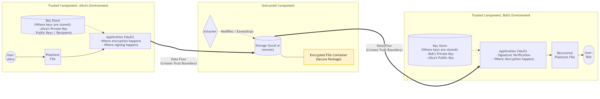

# D1 - Architecture & Threat Model

## 1. System Overview

**Problem to Solve**
The Secure Digital Document Vault (Secure File Exchange Platform) solves the problem of securely transferring files between users over untrusted communication channels or storage mediums. It guarantees that an attacker observing, intercepting, or modifying the data at rest or in transit cannot access the plaintext contents, alter the file undetected, or impersonate the sender.

**Core Features**
* **End-to-End Protection:** Local authenticated encryption (AEAD) of file contents and sensitive metadata before leaving the sender's environment.
* **Controlled Sharing:** Hybrid encryption scheme to securely exchange the symmetric Data Encryption Key (DEK) only with authorized recipients.
* **Authenticity and Non-Repudiation:** Digital signatures applied to the secure package to mathematically prove the sender's identity.
* **Tamper Detection:** Cryptographic verification engine that strictly validates metadata, signatures, and payload integrity before any decryption occurs.
* **CLI Interface:** Command-line driven application logic executed entirely within the user's local host.

**Explicitly Out of Scope**
To focus strictly on applied cryptography, the following elements are out of scope:
* Graphical User Interfaces (GUI) and web applications.
* Cloud infrastructure, centralized authentication servers, and real network protocols.
* Dynamic key distribution centers (Public keys are assumed to be established via local keystores or manual out-of-band exchange).

## 2. Architecture Diagram

**Architectural Details:**
* **Where encryption happens:** Symmetrically within Alice's Secure File Exchange Engine (Trusted Sender boundary) before the file is exposed to the network.
* **Where signing happens:** Following encryption, the package is signed inside Alice's Secure File Exchange Engine using her private key.
* **Where keys are stored:** Exclusively in the local Keystores of the respective trusted client environments. Private keys never cross trust boundaries.

## 3. Security Requirements

* **Confidentiality of file contents:** An attacker who obtains the encrypted container from the untrusted storage must not be able to learn the file contents without the correct private key.
* **Integrity of file contents:** Any unauthorized modification to the encrypted file container must be strictly detectable by the recipient application before decryption occurs.
* **Authenticity of file sender:** The system must guarantee that the recipient can mathematically verify that the secure package originated from the expected sender, and an attacker cannot forge a package claiming to be from them.
* **Confidentiality of private keys:** Private keys must never leave the user local keystore in plaintext, ensuring an attacker with access to the transfer channel cannot extract or compromise them.
* **Protection against tampering:** The system must verify the integrity of all sensitive metadata and the payload together; if an attacker alters recipient IDs or timestamps, the application must safely reject the package.

## 4. Threat Model

**Assets to protect:**
* **File contents:** The original information exchanged between users.
* **File metadata:** Sensitive details such as file names, sizes, and recipient identities.
* **File keys (DEK):** The random symmetric key that encrypts one file. It only exists in memory and, wrapped, inside the container.
* **Private keys:** The users' asymmetric private keys (P-256 for decryption, Ed25519 for signing), stored encrypted in the keystore.
* **Passwords:** User credentials required to unlock local keystores.
* **Signature validity:** The cryptographic proof linking the file to the sender identity.

**Adversaries:**
* External attacker with read and write access to the untrusted stored containers or shared folder.
* Network eavesdropper monitoring the communication channel to capture packages.
* Active attacker attempting to modify metadata, replay packages, or alter the payload in transit.

**What attackers can do:**
* Intercept, copy, and read any encrypted data or exposed metadata traversing the untrusted environment.
* Modify the secure package, flip bits in the ciphertext, or alter unencrypted metadata directly on the storage medium.
* Delete legitimate packages to cause a denial of service.
* Attempt to replay an older, valid package to trick the recipient.

**What attackers cannot do:**
* Access the local trusted environments or devices of the sender and recipient.
* Extract plaintext private keys from the secure local keystores.
* Bypass cryptographic mathematics, such as guessing a 256-bit key or forging a digital signature without possessing the private key.

## 5. Trust Assumptions

* Users protect their passwords and do not expose them to third parties.
* Public keys are authentic and correctly associated with their respective owners through a prior secure exchange.
* The operating system provides secure randomness for key generation and cryptographic nonces.
* The storage location and transfer channels are completely untrusted and accessible to attackers.
* The local client environments of both the sender and the recipient are secure and free of malware that could steal data before encryption or after decryption.

## 6. Attack Surface Review

* **File input:**
  * *What could go wrong:* An attacker could provide a maliciously crafted file, an excessively large file, or manipulate the file path.
  * *Security property at risk:* Availability and Integrity.
* **Metadata parsing:**
  * *What could go wrong:* An attacker modifies recipient IDs, file names, or timestamps in the package to trick the application during parsing.
  * *Security property at risk:* Confidentiality and Integrity.
* **Key import/export:**
  * *What could go wrong:* A user accidentally imports a compromised public key, or the system loads a substituted key provided by an attacker.
  * *Security property at risk:* Authenticity and Confidentiality.
* **Password entry:**
  * *What could go wrong:* Weak passwords could be brute-forced, or the CLI might expose the password in the terminal history.
  * *Security property at risk:* Confidentiality of private keys.
* **Sharing workflow:**
  * *What could go wrong:* The sender accidentally selects the wrong recipient public key, encrypting the file for an unauthorized user.
  * *Security property at risk:* Confidentiality of file contents.
* **Signature verification:**
  * *What could go wrong:* The verification engine accepts a malformed signature or fails to properly link the signature to the encrypted payload.
  * *Security property at risk:* Authenticity and Protection against tampering.
* **CLI input:**
  * *What could go wrong:* The application receives untrusted values through the menu (file names, paths, contact names, recipient lists) or values copied from untrusted packages (e.g. the filename stored in a container), which could be used to overwrite or escape folders (`../../`).
  * *Security property at risk:* Integrity and Availability.

> **Revision note (final system):** sections 7–12 below were added after the D1 review. They develop concrete attack scenarios, extend the attack surface (package parsing, untrusted storage, authenticated decryption, file recovery, trust and replay state) and map every asset and threat to a requirement, a design constraint and the test that verifies it.

## 7. Adversaries (refined)

| ID | Adversary | Capabilities | Not capable of |
|---|---|---|---|
| **A1** | Storage / channel attacker | Reads, copies, modifies, deletes, reorders and re-delivers any `.vault` in the shared folder or network channel. | Accessing the users' devices. |
| **A2** | Impersonator | Has her own valid key pairs; publishes fake public-key bundles; signs her own packages. | Using another user's private key. |
| **A3** | Device / backup thief | Obtains a copy of a keystore file or a backup (stolen laptop, USB drive) and tries passwords offline. | Knowing the user's password. |
| **A4** | Former or malicious recipient | Was a legitimate recipient of a file (knows its DEK) and tries to modify the header or re-send it as if it came from the original sender. | Signing with the sender's key. |
| **A5** | Malformed-input attacker | Crafts malformed packages, bundles or keystores (truncated, invalid Base64, huge numbers, invalid curve points) to crash the parser or trigger unintended behavior. | — |

The local environment of each user (application, memory, trust store, replay cache) is **trusted** (assumption §5): malware on the user's device is out of scope.

## 8. Extended Attack Surface

| Interface | Untrusted input | What could go wrong | Property at risk | Control |
|---|---|---|---|---|
| **Secure package parsing** | `.vault` bytes from shared storage | Invalid JSON/UTF-8, duplicated keys, extra unsigned fields, wrong types, huge or truncated fields, invalid Base64, old versions (downgrade) | Integrity, availability | Strict parser `parse_container()`: exact field set, types, lengths, Base64, version and algorithms → `ContainerFormatError` |
| **Untrusted storage** | Whole package | Modification, substitution of the sender, re-delivery of old packages, deletion | Integrity, authenticity, freshness | Ed25519 signature over all fields, trusted signer lookup, replay guard; deletion = availability, out of scope |
| **Authenticated decryption** | Ciphertext, tag, nonces, capsules | Bit flips, capsule swapping between recipients or files, invalid-curve ephemeral keys, error messages that reveal which check failed | Confidentiality, integrity | Verify signature **before** any key operation; capsule validation (125 bytes, point on curve); context-bound HKDF/AAD; AES-GCM tag; specific errors raised `from None`, no plaintext returned on failure |
| **File recovery (writing the output)** | Filename stored in the package | Path traversal (`../../.bashrc`), overwriting existing files, writing unverified plaintext | Integrity, availability | Output name sanitized to a plain file name; existing files are never overwritten; the file is written only after every check succeeds |
| **Key import (public-key bundles)** | Bundle file | Substituted key under a known name, corrupted bundle, wrong key types | Authenticity, confidentiality | Fingerprint shown and optionally checked against the confirmed value; key-change detection; type checks |
| **Keystore files** | Keystore JSON on disk | Tampered metadata or KDF parameters (downgrade or huge iteration counts), swapped ciphertexts, overwriting | Confidentiality of private keys, availability | Whole header as AES-GCM AAD; iterations bounded (600,000–10,000,000); no overwrite by default |
| **Password entry** | User password | Weak passwords, echo on screen, storage | Confidentiality of private keys | `getpass` (no echo), never stored, policy (length, common list, sequences) |
| **Trust store / replay cache** | Local state files | Corruption | Authenticity, freshness | Validated on load; a corrupted cache raises an error instead of disabling the protection |

## 9. Concrete Attack Scenarios

| ID | Scenario | Attacker | Steps | Expected result | Verified by |
|---|---|---|---|---|---|
| **S1** | Read a stolen package | A1 | Copies `report.vault` and tries to read it | Only ciphertext; without a recipient private key nothing is learned | `test_2_vault_file_on_disk_does_not_reveal_plaintext` |
| **S2** | Bit flip in the ciphertext | A1 | Flips one bit of `ciphertext`, `tag` or `nonce` | Signature rejected before decrypting | `test_1_tampered_vault_on_disk_rejected_for_every_field` |
| **S3** | Recipient list manipulation | A1 | Adds herself, removes a recipient or renames one | Signature rejected (the list is signed and in the AAD) | `test_4/5` (D3), `test_7_modified_recipients_rejected` |
| **S4** | Non-recipient impersonation | A2 | Uses the label `"Bob"` with her own key | Access denied: entries are found by key fingerprint | `test_access_decided_by_key_not_by_label` |
| **S5** | Signature stripping and re-signing | A2 / A4 | Modifies a package and signs it with her own key | Rejected: the recipient verifies with the key trusted for the expected sender | `test_8_forged_container_resigned_by_attacker_rejected`, `test_3_eve_resigns_container_with_her_own_keystore_key` |
| **S6** | Key substitution | A2 | Publishes a bundle named "Alice" with her keys | Fingerprint mismatch / key-change warning; not trusted | `test_3_key_substitution_attack_detected` |
| **S7** | Replay of an old package | A1 | Re-delivers a genuine package already received, or one older than 30 days | Rejected by the replay guard | `test_8_replayed_package_rejected`, `test_10_stale_package_rejected` |
| **S8** | Capsule swapping | A4 | Moves Bob's wrapped key into Carol's entry, or from another file | Unwrapping fails (context binding / different DEK) | `test_capsule_moved_to_other_recipient_rejected` |
| **S9** | Invalid-curve ephemeral key | A5 | Puts a point that is not on P-256 in a capsule | Rejected before ECDH | `test_structurally_invalid_capsules_rejected_as_format_errors` |
| **S10** | Malformed package | A5 | Truncated, empty, non-UTF-8 or random package | `ContainerFormatError`, no crash | `test_malformed_container_bytes`, `test_2_corrupted_or_truncated_vault_file_rejected` |
| **S11** | Stolen keystore, offline guessing | A3 | Tries common passwords against a copied keystore | Each guess costs 600,000 PBKDF2 iterations; common passwords are not allowed | `test_5_stolen_keystore_alone_cannot_decrypt`, `TestPasswordPolicy` |
| **S12** | Keystore tampering | A3 | Lowers iterations, sets 10¹² iterations, changes `key_id` or status | Rejected (bounds checked before deriving, header authenticated) | `test_3_modified_keystore_failure`, `TestKdfParameterBounds` |
| **S13** | Use of a compromised key | A2 / A3 | Sends files signed with a key that was reported stolen | Rejected: the key is revoked in the trust store | `test_5_revoked_sender_key_rejects_old_and_new_files` |
| **S14** | Path traversal on recovery | A2 | Signs a package whose filename is `../../.bashrc` | The name is reduced to a plain file name (`../../.bashrc` → `bashrc`) and written only inside the user's inbox, never overwriting | `test_output_filename_is_sanitized` (`tests/integration/test_app_flow.py`) |

## 10. Traceability Matrix

| Asset | Threat | Scenarios | Security requirement | Design constraint / control |
|---|---|---|---|---|
| File contents | Disclosure | S1, S4 | R1 Confidentiality | AES-256-GCM with a fresh DEK per file; DEK wrapped per recipient with ECIES (ECDH P-256 + HKDF-SHA256 + AES-256-GCM); entries found by key fingerprint |
| File contents | Modification | S2, S8 | R2 Integrity | Ed25519 signature verified first; AES-GCM tag over ciphertext with the header as AAD; context-bound key wrap |
| File metadata (name, timestamp, recipients) | Modification | S3, S7 | R5 Tamper protection | Metadata, recipients and signer ID signed and in the AAD |
| File key (DEK) | Disclosure / reuse | S8 | R1 + nonce safety | Random 256-bit DEK used for exactly one file; 96-bit random nonce; KEK ≠ DEK |
| Recipient authorization | Unauthorized access, list manipulation | S3, S4 | R6 Recipient authorization | Recipient = fingerprint of a trusted public key; expected fingerprint checked before encrypting; list signed |
| Sender identity | Forgery, re-signing, substitution | S5, S6 | R3 Authenticity | Verification only with the key trusted for the expected sender (trust store); key-change detection |
| Freshness | Replay | S7 | R7 Freshness | Signed timestamp, 30-day window, per-user cache of accepted packages |
| Private keys | Theft, offline guessing, tampering | S11, S12 | R4 Confidentiality of private keys | PBKDF2-HMAC-SHA256 (600k) + AES-256-GCM keystore; whole header as AAD; password policy; bounded iterations |
| Private keys | Compromise | S13 | R8 Lifecycle | Rotation (retired keys open old files), revocation (refused forever), expiration, verified backup/restore |
| Availability of the app | Malformed input, DoS | S9, S10, S12 | R9 Robust parsing | Strict validation of every field before use; size limits; specific exceptions |
| User's file system | Path traversal, overwrite | S14 | R10 Safe file recovery | Sanitized output names; no overwrite; write only after successful verification |

## 11. Clarified Assumptions

* **File-key protection:** the DEK is generated with the OS CSPRNG, used for one file only, never stored in plaintext, and wrapped separately for each recipient with a key-encryption key derived from a fresh ephemeral ECDH exchange (see [`D3-Hybrid_Encryption.md`](D3-Hybrid_Encryption.md)).
* **Recipient authorization:** a user is authorized to read a file if and only if the sender included the fingerprint of that user's **trusted** encryption key. Labels (names) are informative only.
* **Sender authenticity:** a package is accepted as coming from X only if it verifies with a signing key that the recipient trusts for X. Trust is established by importing X's public-key bundle and confirming its fingerprint out of band; a fingerprint identifies a key but does not, by itself, prove ownership.
* **Not provided:** protection against malware on the user's device, against a user who reveals their password, against deletion of packages (availability), and against a legitimate recipient who forwards the plaintext.

## 12. Requirements Added After the Review

* **R6 Recipient authorization:** only holders of the trusted keys chosen by the sender can recover the DEK, and the recipient list cannot be modified.
* **R7 Freshness:** a package cannot be accepted twice by the same user nor accepted outside its validity window.
* **R8 Key lifecycle:** keys can be rotated, revoked and recovered without losing access to legitimate old files.
* **R9 Robust parsing:** every untrusted input is validated before use; malformed input produces a controlled error.
* **R10 Safe file recovery:** recovering a file never writes outside the user's folder nor overwrites existing files.
