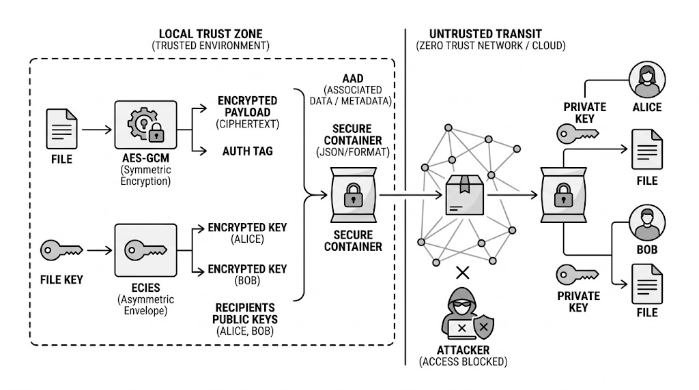

# Cryptography — Secure Digital Document Vault

This is the repository for the development of the Cryptography project.

<p align="center">
  
</p>

The team consists of:

* Carballo Ramírez Hanny
* Monter González Luis Enrique
* Siliano Haller Rodrigo
* Romero Zamorano Rosa Jennifer

---

## What it does

The **Secure Digital Document Vault** lets a user encrypt a file and share it securely with one or more recipients using **Hybrid Encryption (`AES-GCM-256 + ECIES(P-256)`)**:

* The file is encrypted **once** with a random 256-bit file key (AES-256-GCM).
* The file key is wrapped **individually for each recipient** with their public key (ECIES: ECDH + HKDF-SHA256 + AES-GCM).
* The header (metadata + recipient list) is authenticated as **AAD**, so any modification to the file, the metadata or the recipient list makes decryption fail.
* **(D5)** The creator **signs** the whole container with **Ed25519** (SHA-256 digest of ciphertext + tag + nonce + metadata + recipients + signer ID). The recipient **verifies the signature with the sender's public key before decrypting**, so forged, re-signed, unsigned or tampered files are rejected.

## Architecture



1. Alice encrypts the file with a fresh **file key** (AES-GCM) → ciphertext + authentication tag.
2. The file key is encrypted with ECIES for each recipient's public key (Alice, Bob).
3. The container (metadata, recipients, nonce, ciphertext, tag) is **signed with Ed25519** by the sender and stored as a JSON **secure container**: `{format, version, metadata, recipients, nonce, ciphertext, tag, signer_id, signature}` (see [`D5-Digital_Signatures.md`](D5-Digital_Signatures.md)).
4. The container travels through an **untrusted** channel/storage where an attacker may read or modify it.
5. Each recipient first **verifies the signature** with the sender's public key, then uses **their own private key** to unwrap the file key and decrypt. An attacker without a listed private key, a modified container, or a forged signature is rejected.

The original threat model diagram from Deliverable 1 is in [`D1_Architecture_Threat_Model.md`](D1_Architecture_Threat_Model.md).

## Documentation by deliverable

| Deliverable | Document |
|---|---|
| D1 — Architecture & Threat Model | [`D1_Architecture_Threat_Model.md`](D1_Architecture_Threat_Model.md) |
| D2 — Secure Symmetric Encryption Module | [`D2 - Secure Symmetric Encryption Module.md`](D2%20-%20Secure%20Symmetric%20Encryption%20Module.md) |
| D3 — Hybrid Encryption (multi-recipient) | [`D3-Hybrid_Encryption.md`](D3-Hybrid_Encryption.md) |
| D4 — Midterm System Presentation & Security Review | [Slides (Genially)](https://view.genially.com/6ae7e53c6fd0bfcb5d875c20) · Demo: [`demo.py`](demo.py) |
| D5 — Digital Signatures | [`D5-Digital_Signatures.md`](D5-Digital_Signatures.md) |

## Repository structure

```text
Cryptography/
├── .github/workflows/python-tests.yml   # CI: runs unit tests on push / PR
├── vault/
│   └── crypto_module.py                 # SecureEncryptionModule (hybrid encryption engine)
├── tests/
│   ├── test_crypto.py                   # D3 security unit tests
│   └── test_signatures.py               # D5 digital signature tests
├── demo.py                              # Interactive end-to-end demo
├── architecture_d3.png                  # Architecture diagram (hybrid encryption)
├── diagrama.png                         # D1 threat model diagram
├── requirements.txt
└── README.md
```

---

## Instructions

### 1. Requirements

* Python 3.10 or newer
* Git (or download the repository as ZIP from GitHub)

### 2. Get the code

```bash
git clone https://github.com/romzamorano/Cryptography.git
cd Cryptography
```

### 3. Install dependencies

```bash
pip install -r requirements.txt
```

### 4. Run the demo

```bash
python demo.py
```

Press **Enter** to move between sections. Everything is shown in the terminal, and the generated files are saved in `demo_files/`.

> **Note:** Up to D5, `demo.py` stores the private keys (P-256 and Ed25519) **unencrypted** in `demo_files/` for demonstration purposes. This is addressed in **D6 — Key Management**, where private keys are stored in an encrypted keystore protected with a password-derived key (KDF) and the password is requested only when a key is needed, as required by the *Confidentiality of private keys* requirement in [`D1_Architecture_Threat_Model.md`](D1_Architecture_Threat_Model.md).

| Section | What it shows | Expected result |
|---|---|---|
| 1. Encrypt a file | Alice encrypts `secret.txt` and decrypts it | ✅ Decrypted file is identical to the original |
| 2. Share with another user | File encrypted for Alice **and** Bob | ✅ Bob decrypts with his own private key |
| 3. Non-recipient | Eve tries with her ID, then impersonating Bob | ❌ Access denied in both cases |
| 4. Modified file | One bit of ciphertext flipped, recipient list edited, filename changed | ❌ Signature rejected in all cases |
| 5. Digital signatures (D5) | Valid signature, wrong public key, file re-signed by Eve, signature removed | ✅ / ❌ Only Alice's genuine signature is accepted |

### 5. Run the unit tests

```bash
python -m unittest discover -s tests -v
```

| Test | Verifies |
|---|---|
| `test_1_shared_two_users_both_decrypt` | Both recipients can decrypt the shared file |
| `test_2_unauthorized_user_cannot_decrypt` | A user not in the recipient list is rejected |
| `test_3_wrong_private_key_fails` | Using a recipient's ID with another private key fails |
| `test_4_tampered_recipient_list_fails` | Editing the recipient list breaks the AAD and decryption fails |
| `test_5_removing_recipient_breaks_access` | Removing a recipient breaks access for everyone |
| `test_signatures.py` (D5) | Valid signature accepted; modified ciphertext, modified metadata, wrong public key and removed signature rejected (+ forged / re-signed containers) |

The same tests run automatically on GitHub Actions on every push to `main`.

---

## Using the module in your own code

```python
from cryptography.hazmat.primitives.asymmetric import ec
from vault.crypto_module import SecureEncryptionModule

vault = SecureEncryptionModule()
alice_priv = ec.generate_private_key(ec.SECP256R1())   # encryption key (P-256)
bob_priv = ec.generate_private_key(ec.SECP256R1())
alice_sign_priv, alice_sign_pub = SecureEncryptionModule.generate_signing_keypair()  # signing key (Ed25519)

container = vault.encrypt_file(
    b"secret data",
    recipients=[
        {"id": "Alice", "public_key": alice_priv.public_key()},
        {"id": "Bob", "public_key": bob_priv.public_key()},
    ],
    filename="secret.txt",
    signer_private_key=alice_sign_priv,
)

plaintext = vault.decrypt_file(container, bob_priv, "Bob", alice_sign_pub)   # works
# vault.decrypt_file(container, bob_priv, "Bob", eve_sign_pub)               # raises ValueError (wrong signer)
```
