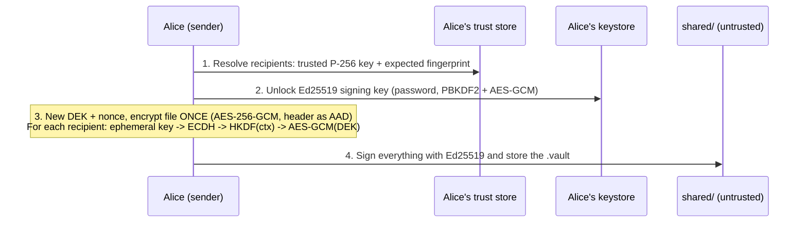
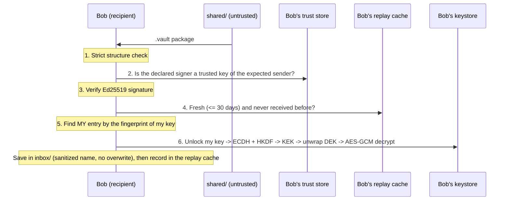

# Secure Digital Document Vault — Final Documentation

**Cryptography · Group 04 · Team 07**

* Carballo Ramírez Hanny
* Monter González Luis Enrique
* Romero Zamorano Rosa Jennifer
* Siliano Haller Rodrigo

This document describes the **final system** as a whole: what it does, how it is built, which cryptographic algorithms it uses and why, the threat model and how every threat is mitigated, the use cases, and how everything is tested. The documents of each deliverable ([D1](D1_Architecture_Threat_Model.md), [D2](D2%20-%20Secure%20Symmetric%20Encryption%20Module.md), [D3](D3-Hybrid_Encryption.md), [D5](D5-Digital_Signatures.md), [D6](D6-Key_Management.md)) are kept in this folder as the history of each submission; where they differ from this document, this document describes the current code. A shorter security-focused summary is in [SECURITY.md](SECURITY.md).

## Contents

1. [Overview](#1-overview)
2. [Architecture](#2-architecture)
3. [Threat model](#3-threat-model)
4. [Cryptographic design](#4-cryptographic-design) (including the [canonicalization strategy](#43-canonicalization-strategy))
5. [Data formats](#5-data-formats)
6. [Workflows](#6-workflows)
7. [Key management](#7-key-management)
8. [Use cases (interactive menu)](#8-use-cases-interactive-menu)
9. [Attack lab](#9-attack-lab)
10. [Error handling and input validation](#10-error-handling-and-input-validation)
11. [Testing](#11-testing)
12. [How the feedback of each deliverable was addressed](#12-how-the-feedback-of-each-deliverable-was-addressed)
13. [Limitations and future work](#13-limitations-and-future-work)
14. [Appendix: complete list of tests](#14-appendix-complete-list-of-tests)

---

## 1. Overview

### 1.1 Problem

Users need to exchange files through a storage location or channel that is **not trusted** (a shared folder, a cloud drive, a USB stick, a network). Anybody with access to it can read, copy, modify, delete or re-deliver what is stored there.

### 1.2 What the system guarantees

| Property | Meaning in this system | How it is achieved |
|---|---|---|
| **Confidentiality** | Only the chosen recipients can read a file. | AES-256-GCM with a fresh file key per file; the file key is wrapped for each recipient with ECIES (ECDH P-256 + HKDF-SHA256 + AES-256-GCM). |
| **Integrity** | Any modification, even one bit, is detected. | Ed25519 signature over the whole package + AES-GCM tag with the header as AAD. |
| **Sender authenticity** | The recipient knows who sent the file. | The signature is verified with the key the recipient **trusts** for the expected sender (trust store). |
| **Recipient authorization** | Nobody can be added to or removed from the recipient list. | Recipients are identified by the SHA-256 fingerprint of their public key; the list is signed and authenticated as AAD. |
| **Freshness** | An old or already-received package is not accepted as new. | Signed timestamp (30-day window) + per-user cache of received packages. |
| **Private-key protection** | Stealing the computer or a backup is not enough to use the keys. | Password-protected keystore: PBKDF2-HMAC-SHA256 (600,000 iterations) + AES-256-GCM, whole header authenticated. |
| **Robustness** | Malformed input never crashes the program nor writes unverified data. | Strict validation of every field, specific exceptions, sanitized output names, no overwriting. |

### 1.3 Scope

* **In scope:** applied cryptography for local, file-based exchange, operated through a command-line interface (CLI).
* **Out of scope:** graphical interfaces, servers, real network protocols, a public-key infrastructure (PKI), and protection of the user's own device against malware.

### 1.4 Trust boundaries

* **Trusted:** each user's local environment: the application, their keystores, their contacts (trust store) and their replay cache.
* **Untrusted:** the shared folder (`vault_home/shared/`) where packages travel, and the public-key bundles (`vault_home/public/`), which anybody could replace.

---

## 2. Architecture

### 2.1 Modules

```text
vault_cli.py --> src/vault/cli.py (menu) --> src/vault/app.py (use cases) --> crypto_module.py  (AES-GCM, ECIES, Ed25519)
                                                                          --> keystore.py       (encrypted private keys)
                                         --> src/vault/attack_lab.py       --> trust_store.py    (trusted contacts)
                                                                          --> replay_guard.py   (freshness, replay cache)
                                                                          --> errors.py         (exception hierarchy)
```

| File | Responsibility |
|---|---|
| `vault_cli.py` | Main program: `python vault_cli.py [--home DIR]`. |
| `src/vault/cli.py` | Interactive menu. It only asks for input and prints results (ASCII only, so it works in any terminal). |
| `src/vault/app.py` | Use cases: users, contacts, send, receive, rotation, revocation, backup/restore. Reports every verification step. |
| `src/vault/attack_lab.py` | 17 attacks from the threat model executed on the real application flow, in a sandbox. |
| `src/vault/crypto_module.py` | `SecureEncryptionModule`: hybrid encryption, signing, strict parsing and verification of packages. |
| `src/vault/keystore.py` | `SecureKeyStore`: encrypted storage of private keys, rotation, revocation, expiration, backup/restore. |
| `src/vault/trust_store.py` | `TrustStore`: trusted public keys of each contact, public-key bundles, key-change detection, revocation. |
| `src/vault/replay_guard.py` | `ReplayGuard`: freshness window and cache of received packages. |
| `src/vault/errors.py` | Exception hierarchy: every error is a `VaultError` (a `ValueError`). |
| `examples/demo.py` | Short scripted demonstration of the cryptography (used in D4). |

The menu contains no security logic: every use case lives in `src/vault/app.py`, which is what the automated tests exercise. The project uses the standard *src layout*: `pyproject.toml` declares the package and `requirements.txt` installs it in editable mode.

### 2.2 Data folders

```text
vault_home/                         (ignored by Git)
├── shared/                         UNTRUSTED channel: .vault packages are left here
├── public/<name>.pub.json          published public-key bundles (also untrusted)
├── backups/<name>/                 default folder for encrypted keystore backups
├── attack_lab/                     sandbox of the attack lab (Alice, Bob, Eve)
└── users/<name>/                   each user's LOCAL, trusted environment
    ├── keys/encryption.json        active P-256 keystore (encrypted)
    ├── keys/signing.json           active Ed25519 keystore (encrypted)
    ├── keys/retired/               keys replaced by a rotation (open old files)
    ├── contacts.json               trust store
    ├── replay_cache.json           packages already received
    └── inbox/                      decrypted files
```

---

## 3. Threat model

### 3.1 Assets

| Asset | Description |
|---|---|
| File contents | The information exchanged between users. |
| File metadata | File name, timestamp, recipient list, signer identity. |
| File key (DEK) | Random symmetric key that encrypts one file; exists only in memory and, wrapped, inside the package. |
| Private keys | P-256 (decryption) and Ed25519 (signing) private keys, stored encrypted in keystores. |
| Passwords | Unlock the keystores; never stored. |
| Trust relationships | Which public key belongs to which contact. |

### 3.2 Adversaries

| ID | Adversary | Capabilities | Not capable of |
|---|---|---|---|
| **A1** | Storage / channel attacker | Reads, copies, modifies, deletes, reorders and re-delivers any package. | Accessing the users' devices. |
| **A2** | Impersonator | Has her own valid key pairs; publishes fake public-key bundles; signs her own packages. | Using another user's private key. |
| **A3** | Device / backup thief | Copies a keystore or a backup and tries passwords offline, without limits. | Knowing the user's password. |
| **A4** | Former or malicious recipient | Knows the file key of a file she received; tries to modify it or re-send it as if it came from the original sender. | Signing with the sender's key. |
| **A5** | Malformed-input attacker | Crafts truncated packages, invalid Base64, huge numbers, invalid curve points. | — |

### 3.3 Assumptions

* Each user's device is free of malware and users do not reveal their passwords.
* The operating system provides a cryptographically secure random number generator.
* Public keys are bound to their owners by comparing fingerprints through an independent channel (in person, phone call). A fingerprint **identifies** a key but does not, by itself, prove who owns it.
* Cryptographic primitives are not broken (no 256-bit key guessing, no signature forgery without the private key).

### 3.4 Attack surface

| Interface | Untrusted input | Risk | Control |
|---|---|---|---|
| Package parsing | `.vault` bytes | Malformed JSON/UTF-8, duplicated keys, extra unsigned fields, wrong types or lengths, downgrade | Strict parser: exact field set, types, lengths, strict Base64, version and algorithms checked |
| Untrusted storage | Whole package | Modification, sender substitution, replay, deletion | Ed25519 signature over everything, trusted signer lookup, replay guard (deletion is availability, out of scope) |
| Authenticated decryption | Ciphertext, tag, nonces, capsules | Bit flips, capsule swapping, invalid-curve keys, error oracles | Signature verified first; capsule validation; context-bound key wrap; AES-GCM tag; specific errors without internal details; no plaintext on failure |
| File recovery | File name stored in the package | Path traversal (`../../`), overwriting files, writing unverified data | Sanitized plain file name, written only inside the inbox, never overwriting, only after every check |
| Key import | Public-key bundle | Substituted key under a known name, wrong key types | Fingerprints shown and optionally checked; key-change detection; type checks |
| Keystore files | Keystore JSON | Tampered metadata or KDF parameters, swapped ciphertexts, overwriting | Whole header as AAD; iteration bounds; no overwrite by default |
| Password entry | Password | Weak passwords, echo, storage | `getpass` (no echo), never stored, password policy |
| Local state | Trust store, replay cache | Corruption | Validated on load; a corrupted cache raises an error instead of disabling the protection |

### 3.5 Attack scenarios and mitigations

| ID | Scenario | Adversary | Mitigation | Where it is stopped |
|---|---|---|---|---|
| S1 | Read a stolen package | A1 | AES-256-GCM; the file key exists only wrapped for the recipients | Nothing readable |
| S2 | Flip one bit of the ciphertext, tag or nonce | A1 | Ed25519 signature over everything + AES-GCM tag | Receive step 3 (signature) |
| S3 | Add, remove or rename recipients | A1 | Recipient list signed and authenticated as AAD | Receive step 3 |
| S4 | Non-recipient access / Eve using the label "Bob" | A2 | Entries located by key fingerprint, not by name | Receive step 5 |
| S5 | Strip the signature and re-sign with another key | A2, A4 | Only the key trusted for the expected sender is accepted | Receive steps 1–3 |
| S6 | Key substitution (fake bundle named "Alice") | A2 | Out-of-band fingerprint comparison + key-change detection | When importing |
| S7 | Replay of an old or already-received package | A1 | Signed timestamp (30-day window) + per-user cache | Receive step 4 |
| S8 | Move a capsule to another recipient or file | A4 | Context binding in HKDF/AAD; different file key per file | Receive step 6 (`IntegrityError`) |
| S9 | Ephemeral key not on the curve | A5 | Point validation before ECDH | Receive step 6 (`ContainerFormatError`) |
| S10 | Truncated or random package | A5 | Strict parser | Receive step 1 |
| S11 | Stolen keystore, offline guessing | A3 | PBKDF2 with 600,000 iterations + password policy | Each guess costs 600,000 HMAC computations |
| S12 | Tampered keystore (iterations, key ID, status) | A3 | Iteration bounds checked before deriving; header as AAD | When unlocking |
| S13 | Use of a key reported as stolen | A2, A3 | Revocation in the trust store | Receive step 2 |
| S14 | Malicious file name (`../../.bashrc`) | A2 | Name sanitized (`bashrc`), inbox only, no overwrite | When saving |

### 3.6 Traceability matrix

| Asset | Threat | Scenarios | Requirement | Design constraint / control | Verified by |
|---|---|---|---|---|---|
| File contents | Disclosure | S1, S4 | R1 Confidentiality | AES-256-GCM, fresh DEK per file, ECIES per recipient, fingerprint lookup | `test_2_vault_file_on_disk_does_not_reveal_plaintext`, `test_access_decided_by_key_not_by_label` |
| File contents | Modification | S2, S8 | R2 Integrity | Signature first, AES-GCM tag, context-bound key wrap | `test_1_tampered_vault_on_disk_rejected_for_every_field`, `test_capsule_moved_to_other_recipient_rejected` |
| Sender identity | Forgery, re-signing, substitution | S5, S6 | R3 Authenticity | Trust store, verification with the trusted key, key-change detection | `test_8_forged_container_resigned_by_attacker_rejected`, `test_3_key_substitution_attack_detected` |
| Private keys | Theft, guessing, tampering | S11, S12 | R4 Private-key confidentiality | PBKDF2 (600k) + AES-GCM keystore, header as AAD, password policy, iteration bounds | `test_5_stolen_keystore_alone_cannot_decrypt`, `TestKdfParameterBounds` |
| Metadata | Modification | S3, S7 | R5 Tamper protection | Metadata, recipients and signer signed and in the AAD | `test_3_modified_metadata_rejected` |
| Recipient list | Unauthorized access, manipulation | S3, S4 | R6 Recipient authorization | Recipient = fingerprint of a trusted key; expected fingerprint checked before encrypting | `test_expected_fingerprint_mismatch_rejected_on_encrypt` |
| Freshness | Replay | S7 | R7 Freshness | Signed timestamp, 30-day window, per-user cache | `test_8_replayed_package_rejected`, `test_10_stale_package_rejected` |
| Private keys | Compromise | S13 | R8 Key lifecycle | Rotation, revocation, expiration, verified backup/restore | `test_5_revoked_sender_key_rejects_old_and_new_files`, `test_key_rotation` |
| Availability | Malformed input, DoS | S9, S10, S12 | R9 Robust parsing | Strict validation, size limits, bounded iterations, specific exceptions | `TestMalformedContainers`, `TestMalformedKeystores` |
| User's file system | Path traversal, overwrite | S14 | R10 Safe file recovery | Sanitized names, inbox only, no overwrite, written only after success | `test_output_filename_is_sanitized` |

---

## 4. Cryptographic design

### 4.1 Algorithms

| Algorithm | Used for | Parameters | Why | Alternative considered |
|---|---|---|---|---|
| **AES-256-GCM** (AEAD) | Encrypting files; wrapping the file key; encrypting private keys in the keystore | 256-bit key, random 96-bit nonce, 128-bit tag | Confidentiality, integrity and authentication of associated data in one standard primitive (NIST SP 800-38D); hardware accelerated (AES-NI); never returns plaintext if the tag fails | ChaCha20-Poly1305: equally secure, faster without AES-NI. AES-CBC + HMAC: easier to misuse (padding oracles, wrong order) |
| **ECDH on P-256** (secp256r1) | Agreeing a secret between an ephemeral sender key and the recipient's public key | NIST P-256; a new ephemeral key per recipient and per file | ~128-bit security with short keys; NIST standard; the project forbids RSA; ephemeral keys give a different secret every time | RSA-OAEP: forbidden in the project, larger keys. X25519: valid; P-256 chosen as the NIST curve seen in class |
| **HKDF-SHA256** | Deriving the key-encryption key (KEK) from the ECDH secret | 32-byte output; `info` = protocol version + recipient fingerprint + ephemeral key | The ECDH secret is not uniformly random; HKDF turns it into a proper AES key and provides domain separation through `info` | Using the ECDH secret directly as an AES key: not uniform, no context binding |
| **Ed25519** | Signing the whole package | 32-byte keys, 64-byte signatures (RFC 8032) | Fast; deterministic (no random nonce per signature, avoiding ECDSA's nonce-reuse key leak); non-malleable; no parameters to choose | ECDSA P-256: a repeated or biased nonce leaks the private key |
| **SHA-256** | Key fingerprints; digest of the signed data; package identifier for replay protection; backup verification | 256 bits | Collision resistant; fixed-size identifiers | — |
| **PBKDF2-HMAC-SHA256** | Deriving the key that encrypts each private key from the user's password | 600,000 iterations (default and minimum), maximum 10,000,000; 16-byte salt; 32-byte output | NIST SP 800-132, RFC 8018; seen in class; one cost parameter, easy to validate; 600,000 is the OWASP value | Argon2id / scrypt are memory-hard (better against GPUs); Argon2id requires a recent `cryptography` release; the format allows migrating |
| **OS CSPRNG** (`os.urandom`) | File keys, nonces, salts, ephemeral keys | — | Cryptographically secure randomness | Python's `random`: predictable |

### 4.2 Design decisions

| Decision | Explanation |
|---|---|
| **Hybrid encryption** | Public-key cryptography is slow and limited in size; symmetric cryptography is fast. The file is encrypted once with AES and only its 32-byte key is protected with each recipient's public key. |
| **DEK ≠ KEK** | The **DEK** (file key) is random, encrypts the file contents and is used for one file. The **KEK** (key-encryption key) is derived with ECDH + HKDF for one recipient and only encrypts the DEK. |
| **One DEK per file** | Each DEK encrypts exactly one message, so a (key, nonce) pair never repeats. With random 96-bit nonces the collision probability after *q* messages under one key is ≈ q²/2⁹⁷ and NIST limits random nonces to 2³² messages per key; here q = 1. |
| **Encrypt-then-sign** | The ciphertext and the whole header are signed. Tampered packages are rejected without touching the private key or the decryption code, and the signature reveals nothing about the plaintext. |
| **Verify before decrypting** | AES-GCM only proves that *someone who knows the DEK* built the package, and anybody who knows the recipients' public keys can build one. The signature proves *who* built it. Nothing is unwrapped or decrypted before the signature is valid. |
| **Hash and domain separation when signing** | The signed message is `"SDDV-container-signature-v6\0" ‖ SHA-256(canonical JSON of every field except the signature)`. Canonical JSON (sorted keys, no spaces) makes the digest deterministic; the label prevents reusing a signature in another context. |
| **Separate keys for encryption and signing** | P-256 only for ECDH, Ed25519 only for signatures. Using one key for two purposes can create dangerous interactions; separate keys can also be rotated independently. |
| **Recipient = key fingerprint** | `key_id = "p256:" + SHA-256(65-byte uncompressed public point)`. Access is decided by the key actually held, never by a name anybody could write. |
| **Context binding of the key wrap** | `ctx = "SDDV-v6/dek-wrap/" ‖ key_id ‖ "/" ‖ ephemeral point`, used as HKDF `info` **and** as the AAD of the AES-GCM that wraps the DEK. A capsule cannot be reused for another recipient, protocol version or ephemeral key. |
| **Trust on explicit confirmation** | Public keys are trusted only after their fingerprints are confirmed with the owner; a different key under a known name is refused unless the user accepts the change. |

### 4.3 Canonicalization strategy

A signature or a MAC only protects data if signer and verifier compute **exactly the same bytes**. Every value that is signed, authenticated or used as an identifier therefore has **one canonical representation**, and any input that could be interpreted in more than one way is rejected.

| What | Canonical form | Why |
|---|---|---|
| Signed data and AES-GCM AAD (packages) | `_canonical_json()`: `json.dumps(obj, sort_keys=True, separators=(",", ":"), ensure_ascii=True)` | Same bytes regardless of key order, spacing or non-ASCII characters in the stored file: the package on disk can be reformatted without breaking the signature, but changing any **value** does |
| Keystore AAD | Same canonical JSON of `format`, `version`, `metadata` and `kdf_parameters` | The header is authenticated independently of how the file is formatted |
| JSON parsing | Duplicated keys rejected (`object_pairs_hook`); exact field set; strict types (`version` must be the integer 6, not `"6"` nor `true`) | Avoids parser ambiguity (which of two duplicated values is used?) and unsigned or reinterpreted fields |
| Binary values | Standard Base64 decoded with `validate=True` and exact lengths (nonce 12, tag 16, signature 64, capsule 125 bytes) | One accepted encoding per value: no ignored characters, no alternative lengths |
| Key identifiers | `p256:` + SHA-256 of the **65-byte uncompressed** X9.62 point; `ed25519:` + SHA-256 of the **raw 32-byte** key | A key has exactly one fingerprint, whatever format (PEM, DER) it was loaded from; ephemeral keys must use the uncompressed form |
| Signature input | `"SDDV-container-signature-v6\0" ‖ SHA-256(canonical JSON)` | Domain separation: the bytes can only be interpreted as an SDDV v6 package |
| Key-wrap context | `"SDDV-v6/dek-wrap/" ‖ key_id ‖ "/" ‖ ephemeral point` | Unambiguous binding of protocol version, recipient and ephemeral key |
| Output file names | `sanitize_filename()`: `\` → `/`, last path component only, control and reserved characters replaced, leading dots removed, reserved Windows names prefixed, 120 characters max | The name written to disk cannot depend on how the path was spelled (`../`, `..\`, `.hidden`, `CON`) |
| User and contact names | Letters, digits, `-`, `_`, `.`; 1–64 characters; not starting with `.` | Names are also folder names: one safe spelling only |
| Dates | Keystore: UTC ISO 8601 `YYYY-MM-DDTHH:MM:SSZ`; package: integer Unix seconds | No time-zone ambiguity |

Tests: `TestCanonicalization` in `tests/test_security_requirements.py`, plus the duplicated-key, strict-type and Base64 cases of `test_ecies_validation.py` and `test_keystore_hardening.py`.

---

## 5. Data formats

### 5.1 Package (`.vault`, container SDDV version 6, JSON)

```json
{
  "format": "SDDV",
  "version": 6,
  "metadata": {
    "filename": "report.txt",
    "algorithm": "AES-256-GCM",
    "key_wrap": "ECIES-P256-HKDF-SHA256-AES-256-GCM",
    "signature_algorithm": "Ed25519",
    "timestamp": 1763400000
  },
  "recipients": [
    {"id": "Bob", "key_id": "p256:3f1c...", "encrypted_key": "<Base64, 125 bytes>"}
  ],
  "signer_id": "ed25519:9a0b...",
  "nonce": "<Base64, 12 bytes>",
  "ciphertext": "<Base64>",
  "tag": "<Base64, 16 bytes>",
  "signature": "<Base64, 64 bytes>"
}
```

| Field | Encrypted | Signed | AES-GCM AAD |
|---|---|---|---|
| `format`, `version` | No | Yes | Yes |
| `metadata` (file name, algorithms, timestamp) | No | Yes | Yes |
| `recipients` (`id` label, `key_id` fingerprint, capsule) | Only the DEK inside each capsule | Yes | Yes |
| `signer_id` | No | Yes | Yes |
| `nonce`, `ciphertext`, `tag` | The file contents | Yes | — |
| `signature` | No | — | — |

The parser requires **exactly** these fields (no more, no less) and rejects duplicated JSON keys, wrong types, invalid Base64, wrong lengths, other versions or algorithms, and empty or malformed recipient lists.

### 5.2 ECIES capsule (`encrypted_key`, exactly 125 bytes)

```text
+------------------------------------+--------------------+----------------------------------+
| Ephemeral P-256 point (65 B)       | Wrap nonce (12 B)  | Wrapped DEK (32 B) + tag (16 B)  |
| 0x04 || X || Y (uncompressed X9.62)| random             | AES-256-GCM under the KEK        |
+------------------------------------+--------------------+----------------------------------+
```

It is validated before use: strict Base64, exactly 125 bytes, `0x04` prefix and **point on the P-256 curve** (prevents invalid-curve attacks).

### 5.3 Keystore (one JSON file per private key)

| Field | Content |
|---|---|
| `format`, `version` | `"SDDV-KEYSTORE"`, 1 |
| `metadata` | `key_id`, `key_type` (P-256 / Ed25519), `purpose` (encryption / signing), `encryption`, `public_key` (PEM), `public_key_fingerprint`, `created_at`, `expires_at`, `status` (active / retired / compromised) |
| `kdf_parameters` | `algorithm` (PBKDF2HMAC-SHA256), `iterations`, `key_length` (32), `salt` (16 bytes) |
| `nonce`, `encrypted_private_key`, `tag` | The private key (PKCS#8) encrypted with AES-256-GCM |

* **AAD** = `format + version + metadata + kdf_parameters`: changing any value (status, iterations, key ID…) makes unlocking fail.
* Iterations are checked to be between 600,000 and 10,000,000 **before** deriving (downgrade and denial-of-service protection).
* Files are written atomically, with `0600` permissions, and **never overwritten** unless explicitly requested.
* After unlocking, the decrypted key must match the declared type and fingerprint.

### 5.4 Public-key bundle, trust store and replay cache

| File | Content | Validation |
|---|---|---|
| `public/<name>.pub.json` (`SDDV-PUBLIC-KEYS`) | Name, P-256 public key, Ed25519 public key and both fingerprints | Fingerprints must match the keys; key types must be correct. It does **not** prove identity. |
| `users/<name>/contacts.json` (`SDDV-TRUSTSTORE`) | For each contact, the lists of encryption and signing keys with status `active` / `retired` / `revoked` | Every fingerprint is recomputed when loading. |
| `users/<name>/replay_cache.json` (`SDDV-REPLAY-CACHE`) | Identifiers (SHA-256 of the signed data) of accepted packages, with their date | A corrupted cache raises an error instead of disabling the protection. |

---

## 6. Workflows

### 6.1 Create a user

1. The name is validated (letters, digits, `-`, `_`, `.`; it is also a folder name) and so is the password policy.
2. Two key pairs are generated: **P-256** (encryption) and **Ed25519** (signing).
3. Each private key is encrypted in its keystore: PBKDF2 (600,000 iterations, random salt) → AES key → AES-256-GCM with the header as AAD.
4. The public-key bundle is published and the user is added to their own contacts.

### 6.2 Establish trust (exchange public keys)

1. Alice publishes her bundle; Bob imports it.
2. The program shows both fingerprints and warns that anybody can create a bundle with any name.
3. Bob compares the fingerprints with Alice through another channel. Optionally he pastes the fingerprint she gave him: if it does not match, the import is refused.
4. If "Alice" already existed with **different** keys, `KeyChangedError` is raised (possible substitution) and the change is accepted only after Bob confirms it; the previous keys become `retired`.

### 6.3 Send a file



| Step | What happens | Failure |
|---|---|---|
| 1 | Recipients are taken from the **trusted** contacts, with their expected fingerprints | Unknown or revoked contact; key not matching its fingerprint (`RecipientError`, before encrypting) |
| 2 | The sender's signing key is unlocked | Wrong password, compromised or expired key |
| 3 | Fresh DEK and nonce; file encrypted once; DEK wrapped for every recipient | — |
| 4 | Package signed and stored in `shared/` | — |

### 6.4 Receive a file



| Step | Check | Error if it fails |
|---|---|---|
| 1 | Package structure (strict parser) | `ContainerFormatError`; `SignatureError` if unsigned |
| 2 | The declared `signer_id` is a **trusted** key (active or retired, not revoked) of the expected sender | `SignatureError` / `ContactKeyRevokedError` |
| 3 | Ed25519 signature is valid | `SignatureError` |
| 4 | Signed at most 30 days ago (and at most 5 minutes in the future) and not received before | `StaleContainerError` / `ReplayError` |
| 5 | One of **my** keys (active or retired) is listed, found by fingerprint without a password | `AccessDeniedError` |
| 6 | My key is unlocked; ECDH + HKDF → KEK → DEK unwrapped → AES-GCM decrypts and authenticates | `KeystoreAuthError`, `KeyRevokedError`, `IntegrityError` |

The file is written **only if all six steps succeed**: inside `inbox/`, with a sanitized name (`../../.bashrc` → `bashrc`), never overwriting (`report (1).txt`). The package is recorded in the replay cache **after** decrypting, so a tampered copy cannot block the genuine package. Re-opening a package already received is allowed only when the user explicitly confirms it.

---

## 7. Key management

### 7.1 Own keys (keystore)

| Operation | What it does | Effect |
|---|---|---|
| Change password | Decrypts and re-encrypts the **same** key with the new password (new salt and nonce) | The old password stops working |
| Rotate | Creates a new key of the same type; the old one becomes `retired` in `keys/retired/`; the bundle is re-published | The retired key only opens **old** files; contacts must import the new bundle and accept the change |
| Mark as compromised | Status `compromised` | Never usable again (not even for old files) and cannot be rotated |
| Replace a compromised key | Generates a completely new key; the compromised one is archived | Bundle re-published; contacts revoke the old key and import the new one |
| Expiration | `expires_at` in the metadata | An expired key is inactive (old files only) |
| Backup | Copies the **encrypted** keystore (no password needed), verifies the copy byte by byte, never overwrites another backup | The password cannot be recovered: without it the backup is useless |
| Restore | Verifies password, integrity and **identity** (expected fingerprint) **before** copying | Refuses another person's key and tampered backups |

### 7.2 Contacts' keys (trust store)

| Status | Verify old files | Encrypt new files | When |
|---|---|---|---|
| `active` | Yes | Yes | Current key of the contact |
| `retired` | Yes | No | The contact rotated and the user accepted the change |
| `revoked` | No (old and new) | No | The contact reported a compromise; a revoked key can never be trusted again, not even under another name |

### 7.3 Password policy and offline guessing

Passwords are read with `getpass` (not shown, not stored in the shell history) and are never stored. Policy, applied when a keystore is created or its password is changed: at least 12 characters, not in a list of common passwords, not only digits, at least 5 different characters and no simple sequences (`abcd…`, `1234…`).

A stolen keystore can be attacked offline. With PBKDF2 at 600,000 iterations and an attacker testing about 10⁶ passwords per second on a GPU rig (rough figures):

| Password | Search space | Time |
|---|---|---|
| 8 lowercase letters | 26⁸ ≈ 2×10¹¹ | ≈ 2.4 days |
| 12 lowercase letters | 26¹² ≈ 9.5×10¹⁶ | ≈ 3,000 years |
| 4 random common words | 7,776⁴ ≈ 3.7×10¹⁵ | ≈ 117 years |
| A password from a leaked-password list | ~10⁹ | ≈ 17 minutes |

This is why the policy focuses on length and on rejecting common passwords.

---

## 8. Use cases (interactive menu)

```bash
python vault_cli.py
```

| Menu | Use case | Security controls involved |
|---|---|---|
| 1.1 | Create a user | Password policy, encrypted keystores, validated name, no overwriting |
| 1.2 | Show my keys and fingerprints | Public metadata only (authenticated, not encrypted) |
| 1.3 | Publish my public keys | Bundle with fingerprints for out-of-band comparison |
| 1.4 | Change a keystore password | Policy on the new password; new salt and nonce |
| 1.5 | Rotate a key | Old key retired; contacts must accept the change |
| 1.6 / 1.7 | Mark a key as compromised / replace it | Compromised keys always refused; new key published |
| 1.8 / 1.9 | Back up / restore | Verified copy; restore checks password, integrity and identity |
| 2.1 | Import a contact's public keys | Fingerprints shown and optionally checked; key-change detection |
| 2.2 / 2.3 | List / revoke contacts | Permanent revocation |
| 3 | Send a file (any type, up to 100 MiB) | Trusted recipients only; expected fingerprint; 4 visible steps |
| 4 | Receive / open a file | 6 visible checks; sanitized output; no overwriting; replay protection |
| 5 | Inspect a package | Shows only what an attacker can see (not verified): never the contents nor the DEK |
| 6 | Attack lab | 17 attacks on the real flow (section 9) |
| 7 | Run the automated tests | `python -m unittest discover -s tests` |

A typical session (also described in the README):

1. Create two users (1.1) and exchange their public keys (2.1), confirming fingerprints.
2. Send a file from one to the other (3) and inspect the package (5).
3. Receive it (4): the six checks appear in green. Receive it again: rejected as a replay at step 4.
4. Run the attack lab (6 → A): 17/17 attacks blocked.
5. Run the tests (7): 168 tests, OK.

---

## 9. Attack lab

Option 6 creates a sandbox (`vault_home/attack_lab/`) with **Alice** (sender), **Bob** (recipient) and **Eve** (attacker), whose passwords are fixed and shown on screen. Alice and Bob exchange confirmed keys; Eve downloads both public bundles. Alice sends `payroll.txt` to Bob. Each scenario attacks a **copy** of the package (or a keystore, or the trust store) and runs the **real** receive flow, so the user sees exactly which check stops it. The user's own data is never touched.

| # | Threat | Attack | Expected result |
|---|---|---|---|
| 1 | S1 | Read the package without a key | Only ciphertext is stored |
| 2 | S2 | Flip one bit of the encrypted content | `SignatureError` (step 3) |
| 3 | S3 | Change the file name in the metadata | `SignatureError` (step 3) |
| 4 | S3 | Add Eve to the recipient list | `SignatureError` (step 3) |
| 5 | S3 | Remove a recipient | `SignatureError` (step 3) |
| 6 | S5 | Remove the signature | `SignatureError`: not signed (step 1) |
| 7 | S5 | Eve modifies the package and re-signs it with her key | `SignatureError`: not a trusted key of Alice (step 2) |
| 8 | S4 | Eve (not a recipient) opens the package | `AccessDeniedError` (step 5) |
| 9 | S4 | Eve claims to be "Bob" | `AccessDeniedError`: access is by fingerprint |
| 10 | S10 | Truncated package | `ContainerFormatError` (step 1) |
| 11 | S7 | Deliver the same package again (replay) | `ReplayError` (step 4) |
| 12 | S7 | Genuine package signed 45 days ago | `StaleContainerError` (step 4) |
| 13 | S13 | Package signed with a revoked key | `ContactKeyRevokedError` (step 2) |
| 14 | S6 | Fake bundle named "Alice" | `KeyChangedError` when importing |
| 15 | S11 | Stolen keystore: common passwords | `KeystoreAuthError` on every guess; time per guess shown |
| 16 | S12 | Tampered keystore (low iterations, 10¹² iterations, key ID) | `KeystoreFormatError` / `KeystoreAuthError`, even with the real password |
| 17 | S14 | File name `../../evil.txt` | Saved as `inbox/evil.txt` |

---

## 10. Error handling and input validation

Every exception inherits from `VaultError`, which is a `ValueError`. Errors are raised `from None`, so internal exceptions (such as `InvalidTag`) are not exposed, and no failure ever returns partial plaintext.

| Exception | When |
|---|---|
| `ContainerFormatError` | Malformed or truncated package, invalid Base64, unsupported version or algorithm, invalid capsule |
| `SignatureError` | Missing or invalid signature, signer not trusted for the expected sender |
| `AccessDeniedError` | My key is not among the recipients |
| `IntegrityError` | The AES-GCM tag failed (file key or file) |
| `RecipientError` | Invalid recipient list, or a key that does not match its expected fingerprint |
| `KeystoreFormatError` / `KeystoreAuthError` | Malformed keystore / wrong password or tampered keystore |
| `KeystoreNotFoundError` / `KeystoreExistsError` | Missing keystore / refusing to overwrite an existing one |
| `WeakPasswordError` | Password policy not met |
| `KeyRevokedError` / `KeyInactiveError` | Own key compromised / retired or expired |
| `TrustStoreError`, `ContactNotFoundError`, `KeyChangedError`, `ContactKeyRevokedError` | Contacts: invalid, unknown, key changed, key revoked |
| `ReplayError` / `StaleContainerError` | Package already received / outside the 30-day window |

Size and value limits: input files up to 100 MiB, up to 256 recipients, labels up to 128 characters, keystores up to 64 KiB, passwords up to 1,024 characters, PBKDF2 iterations between 600,000 and 10,000,000.

---

## 11. Testing

### 11.1 How to run

| What | Command | Tests |
|---|---|---|
| Everything | `python -m unittest discover -s tests -v` | 168 |
| Integration tests only | `python -m unittest discover -s tests/integration -t . -v` | 64 |
| One file | `python -m unittest tests.test_trust_store -v` | — |

GitHub Actions runs all the tests on every push and pull request to `main`. Tests use 1,000 PBKDF2 iterations only to run fast; the program always uses 600,000 (checked by `test_default_kdf_parameters`). One or two permission tests are skipped on Windows (they only apply to POSIX file permissions).

### 11.2 Strategy

* **Unit tests** check one module in isolation, with positive cases (the legitimate user succeeds) and many negative cases (each attack is rejected **with the specific exception**).
* **Integration tests** combine keystore, encryption, signatures, trust store and replay guard with real files in temporary folders (deleted afterwards), and drive the application layer and even the menu with scripted keyboard input.
* Techniques: `assertRaises(SpecificError)`, `subTest` (many variants of one attack in a single test), `unittest.mock` (to replace `getpass`, or to prove that ECIES is **never called** when the signature fails), and fake clocks (to simulate old packages without waiting 30 days).

### 11.3 Test files

| File | Tests | What it verifies |
|---|---|---|
| `test_crypto.py` | 5 | Two recipients decrypt; non-recipient, wrong private key, tampered or removed recipient entries rejected |
| `test_signatures.py` | 11 | Valid signature accepted; modified ciphertext, metadata, tag, nonce, recipients or signer, wrong public key, removed signature, extra field and attacker re-signing rejected; signature verified **before** ECIES |
| `test_ecies_validation.py` | 23 | `key_id` = fingerprint; expected fingerprint; access by key, not name; truncated, invalid-Base64, off-curve or modified capsules; capsule moved between recipients or files; malformed containers; errors without internal details; explicit timestamp |
| `test_key_management.py` | 21 | Correct / wrong password, ten keystore modifications, backup → restore, stolen keystore, KDF downgrade, defaults, `0600`, `getpass`, key identity, rotation, compromise, expiration, verified restore |
| `test_keystore_hardening.py` | 19 | No overwrite; huge iteration counts rejected in under one second; corrupted KDF parameters; malformed JSON, Base64 and fields; file errors; password policy; backups never overwritten; restore with expected fingerprint |
| `test_trust_store.py` | 16 | Bundles; expected fingerprints; key-substitution detection; rotation (retired keys); permanent revocation; corrupted trust store |
| `test_replay_guard.py` | 9 | Accepted once; persistent cache; old and future packages rejected; clock tolerance; pruning; stable identifier; corrupted cache does not disable the protection |
| `integration/test_file_sharing_flow.py` | 7 | End-to-end sharing with keystores and real files: identical output, no plaintext on disk, binary / 1 MiB / empty files, three recipients, outsider rejected without writing a file, a fresh container each time |
| `integration/test_attack_scenarios.py` | 7 | Every field of a stored package modified on disk; truncated / empty / random files; Eve re-signing with her keystore key; file from another sender; stolen keystore; Eve's key on Bob's entry |
| `integration/test_key_lifecycle_flow.py` | 8 | Rotation with old and new files; compromised and expired keys; backup → restore → old file opens; tampered backup; password change; identity kept after restore |
| `integration/test_trust_and_replay_flow.py` | 11 | Trusted exchange; unknown sender; key substitution; fingerprint mismatch; revoked sender / recipient; sender rotation; replay; per-recipient cache; stale package; tampered package not recorded |
| `integration/test_app_flow.py` | 22 | Every use case of the menu: folder layout, duplicate user, weak password, invalid names, reported steps, nothing written on failure, replay and explicit re-open, path traversal, rotation, compromise, backup/restore, password change |
| `integration/test_attack_lab.py` | 4 | All 17 attack-lab scenarios blocked by the expected defense, before decryption |
| `integration/test_cli_menu.py` | 5 | A full session typed into the menu (create users, exchange keys, send, receive, replay, inspect), invalid options, weak password and the complete attack lab |
| **Total** | **168** | 104 unit + 64 integration |

---

## 12. How the feedback of each deliverable was addressed

| Deliverable | Feedback | How it was addressed | Where |
|---|---|---|---|
| **D1** | Concrete attack scenarios were missing | 14 scenarios (S1–S14) with adversary, steps, expected result and test | §3.5, [D1 §9](D1_Architecture_Threat_Model.md) |
| D1 | Attack surface omitted package parsing, untrusted storage, authenticated decryption and file recovery | Extended attack surface with controls for each interface | §3.4, [D1 §8](D1_Architecture_Threat_Model.md) |
| D1 | Missing mapping between assets, threats, scenarios, requirements and design constraints | Traceability matrix, including the verifying test | §3.6, [D1 §10](D1_Architecture_Threat_Model.md) |
| D1 | Clarify file-key protection, recipient authorization and sender authenticity | Explicit assumptions and requirements R6–R10 | §3.3, [D1 §11–12](D1_Architecture_Threat_Model.md) |
| **D2** | Documentation did not match the code | D2 document updated to the real files, classes and format | [D2 §6](D2%20-%20Secure%20Symmetric%20Encryption%20Module.md) |
| D2 | Explicit container validation | Strict parser `parse_container()` | §5.1, §10 |
| D2 | Broad exception handler | Exception hierarchy in `src/vault/errors.py`, raised `from None` | §10 |
| D2 | Tests for modified AAD, nonces, ciphertext and malformed containers | `test_signatures.py`, `test_ecies_validation.py` | §11.3 |
| D2 | Probabilistic nonce uniqueness and per-key limits | q²/2⁹⁷ bound, 2³² limit, one DEK per file | §4.2, [D2 §5](D2%20-%20Secure%20Symmetric%20Encryption%20Module.md) |
| **D3** | Recipient identifiers not linked to public keys | `key_id` = SHA-256 fingerprint; expected fingerprint checked; access by fingerprint | §4.2, §5.1 |
| D3 | Validation of the key encapsulation | Fixed 125-byte capsule, prefix and on-curve checks | §5.2 |
| D3 | Context binding of the key derivation | Version, recipient fingerprint and ephemeral key in HKDF `info` and AAD | §4.2 |
| D3 | More negative tests; failed decryption never releases plaintext | 23 tests in `test_ecies_validation.py` | §11.3 |
| D3 | Detailed workflow; distinguish DEK and KEK | Complete workflow and DEK/KEK table | §4.2, §6.3–6.4, [D3](D3-Hybrid_Encryption.md#update-for-the-final-system-container-v6) |
| **D4** | Presentation feedback (check internet and audio, practice timing); no code changes requested | The interactive menu and the attack lab make the live demonstration reproducible and predictable in time | §8, §9 |
| **D5** | Recipient identifier ↔ public key | Addressed as in D3 | §4.2 |
| D5 | Document trust establishment for signing keys | Public-key bundles, out-of-band fingerprint confirmation, trust store | §6.2, §7.2, [D5](D5-Digital_Signatures.md) |
| D5 | Key revocation and replay protection | Revoked keys refused for old and new files; freshness window + replay cache | §6.4, §7.2 |
| **D6** | Incomplete key lifecycle | Rotation, compromise, replacement, expiration, password change, backup/restore, contact-side revocation | §7 |
| D6 | File permissions and accidental overwriting | Atomic writes, `0600`, no overwrite by default | §5.3 |
| D6 | Metadata and KDF parameters not authenticated | Whole header as AAD | §5.3 |
| D6 | KDF choice not justified | PBKDF2 vs scrypt vs Argon2id; offline-guessing analysis | §4.1, §7.3, [D6 §3, §11](D6-Key_Management.md) |
| D6 | Password policy | Length, common list, digits, distinct characters, sequences | §7.3 |
| D6 | Tested backup and recovery with key-identity verification | Verified backups; restore with expected fingerprint | §7.1, §11.3 |
| D6 | Failure handling and tests | Specific keystore exceptions; `test_keystore_hardening.py` | §10, §11.3 |

---

## 13. Limitations and future work

| Limitation | Possible improvement |
|---|---|
| The local device is trusted: no protection against malware or a user who reveals the password | Hardware-backed key storage (TPM, secure enclave, smart cards) |
| Trust depends on comparing fingerprints out of band | A PKI with X.509 certificates, or signed key-transparency logs |
| Revocation must be communicated out of band; each user revokes in their own contacts | Signed revocation certificates distributed with the bundles |
| No protection of availability: packages can be deleted from the shared folder | Redundant storage, delivery receipts |
| A legitimate recipient can forward the plaintext | Out of scope for cryptography (policy / DRM) |
| PBKDF2 is not memory-hard | Migrate keystores to Argon2id (the format already identifies the KDF) |
| Python cannot guarantee that keys are wiped from memory | Native implementation with explicit memory zeroing |
| Package metadata (file name, recipients, dates) is visible, authenticated but not encrypted | Encrypt the file name and pad the ciphertext length |
| On Windows, `chmod 0600` only toggles the read-only flag; access depends on the user profile ACLs | Set explicit Windows ACLs |
| Whole files are encrypted in memory (100 MiB limit) | Streaming AEAD in chunks (with chunk numbering against truncation) |
| Replay cache is per device | Synchronized cache, or sequence numbers per sender |

---

## 14. Appendix: complete list of tests

Generated from the code. The description is the test's docstring when it has one; otherwise the test name describes what it verifies.


### `tests/test_crypto.py` (5)

| Test | Description |
|---|---|
| `test_1_shared_two_users_both_decrypt` | Requirement: file shared with 2 users -> both can decrypt. |
| `test_2_unauthorized_user_cannot_decrypt` | Requirement: unauthorized user cannot decrypt. |
| `test_3_wrong_private_key_fails` | Requirement: wrong private key -> fails. |
| `test_4_tampered_recipient_list_fails` | Requirement: tampered recipient list -> decryption fails. |
| `test_5_removing_recipient_breaks_access` | Requirement: removing a recipient entry -> breaks access. |

### `tests/test_ecies_validation.py` (23)

| Test | Description |
|---|---|
| `test_capsule_from_another_container_rejected` | A capsule from another file (different DEK) does not open this file. |
| `test_capsule_has_fixed_size` |  |
| `test_capsule_moved_to_other_recipient_rejected` | Context binding: Bob's capsule copied into Carol's entry cannot be opened by Carol |
| `test_modified_capsule_parts_rejected_as_integrity_errors` | Valid structure but modified content -> AES-GCM of the key wrap fails. |
| `test_structurally_invalid_capsules_rejected_as_format_errors` |  |
| `test_unmodified_capsule_tampering_detected_by_signature_first` | Without re-signing, any capsule change is caught by the signature (outer layer). |
| `test_all_failures_are_vault_errors_without_internal_cause` |  |
| `test_each_file_uses_a_fresh_file_key_and_nonce` | Random 96-bit nonces are safe here because every file key encrypts exactly one file. |
| `test_explicit_timestamp_is_signed_and_validated` |  |
| `test_tampered_ciphertext_behind_valid_signature_releases_no_plaintext` | Even if the signature layer were bypassed, AES-GCM refuses to return any plaintext. |
| `test_malformed_container_bytes` |  |
| `test_missing_sender_key_rejected` |  |
| `test_non_bytes_input_rejected` |  |
| `test_signature_wrong_length_or_not_base64` |  |
| `test_wrong_field_types_and_values` |  |
| `test_access_decided_by_key_not_by_label` | Eve claims the label 'Bob' with her own key: her fingerprint is not listed -> denied. |
| `test_expected_fingerprint_match_accepted` |  |
| `test_expected_fingerprint_mismatch_rejected_on_encrypt` | The caller expects Bob's fingerprint but passes Eve's key -> refused before encrypting. |
| `test_fingerprint_is_deterministic_and_matches_keystore` |  |
| `test_invalid_recipient_lists_rejected` |  |
| `test_key_id_is_fingerprint_of_public_key` |  |
| `test_label_or_fingerprint_accepted_as_key_id` |  |
| `test_non_p256_private_key_denied` |  |

### `tests/test_key_management.py` (21)

| Test | Description |
|---|---|
| `test_change_password` |  |
| `test_compromised_key_refused` |  |
| `test_default_kdf_parameters` |  |
| `test_ed25519_fingerprint_matches_d5_signer_id` |  |
| `test_expired_key` |  |
| `test_kdf_downgrade_rejected` | A keystore asking for fewer iterations than the minimum is refused. |
| `test_key_identity_consistent` | Fingerprint and public key in the metadata identify the key without the password. |
| `test_key_rotation` | New key is active; old key is retired but can still open OLD files. |
| `test_key_type_mismatch_rejected` |  |
| `test_keystore_file_permissions` |  |
| `test_password_is_prompted_and_not_stored` | Without a password argument the key is unlocked via getpass; the password is not saved. |
| `test_restore_does_not_overwrite_by_default` |  |
| `test_restore_verifies_backup` | Wrong password or tampered backup -> nothing is restored. |
| `test_swapped_private_key_rejected` | Pasting Bob's encrypted key into Alice's keystore (same password) fails. |
| `test_unique_salt_and_nonce` | Same key + same password -> different salt, nonce and ciphertext. |
| `test_weak_password_rejected_on_creation` |  |
| `test_1_correct_password_access_granted` | Correct password -> access granted |
| `test_2_wrong_password_access_denied` | Wrong password -> access denied |
| `test_3_modified_keystore_failure` | Modified keystore -> failure (ciphertext, tag, nonce, salt and metadata) |
| `test_4_backup_restore_works` | Backup -> restore works |
| `test_5_stolen_keystore_alone_cannot_decrypt` | Stolen keystore alone -> cannot decrypt (neither the key nor Alice's files) |

### `tests/test_keystore_hardening.py` (19)

| Test | Description |
|---|---|
| `test_backup_is_identical_copy_and_never_overwritten` |  |
| `test_full_recovery_after_losing_the_keystore` |  |
| `test_restore_from_missing_backup_is_controlled` |  |
| `test_restore_verifies_expected_fingerprint` | Key-identity verification: a valid backup of ANOTHER key is refused. |
| `test_corrupted_kdf_parameters_rejected` |  |
| `test_huge_iteration_count_rejected_before_deriving` | An attacker sets 10^12 iterations: rejected immediately instead of hanging the app. |
| `test_iterations_at_maximum_are_accepted_by_the_parser` |  |
| `test_errors_are_specific_vault_errors_without_internal_cause` |  |
| `test_file_errors_are_controlled` |  |
| `test_malformed_files_rejected` |  |
| `test_missing_or_wrongly_typed_fields_rejected` |  |
| `test_unreadable_file_is_controlled` |  |
| `test_creating_over_existing_keystore_is_refused` |  |
| `test_explicit_overwrite_is_allowed` |  |
| `test_no_temporary_files_left_behind` |  |
| `test_rotation_never_overwrites_an_existing_new_keystore` |  |
| `test_change_password_applies_policy` |  |
| `test_strong_passwords_accepted` |  |
| `test_weak_passwords_rejected` |  |

### `tests/test_replay_guard.py` (9)

| Test | Description |
|---|---|
| `test_cache_pruned_outside_window` |  |
| `test_corrupted_cache_does_not_disable_protection` |  |
| `test_fresh_package_accepted_once` |  |
| `test_id_independent_of_signature_and_changes_with_content` |  |
| `test_old_package_rejected` |  |
| `test_package_from_the_future_rejected` |  |
| `test_seen_cache_is_persistent` |  |
| `test_small_clock_difference_tolerated` |  |
| `test_stale_error_is_a_replay_error` |  |

### `tests/test_signatures.py` (11)

| Test | Description |
|---|---|
| `test_10_extra_unsigned_field_rejected` |  |
| `test_11_signature_verified_before_decryption` | If the signature fails, ECIES and AES-GCM are NEVER reached. |
| `test_1_valid_signature_file_accepted` | Valid signature -> file accepted. |
| `test_2_modified_ciphertext_rejected` | Modified ciphertext -> rejected. |
| `test_3_modified_metadata_rejected` | Modified metadata -> rejected. |
| `test_4_wrong_public_key_rejected` | Wrong public key -> rejected. |
| `test_5_signature_removed_rejected` | Signature removed -> rejected. |
| `test_6_modified_tag_or_nonce_rejected` |  |
| `test_7_modified_recipients_rejected` |  |
| `test_8_forged_container_resigned_by_attacker_rejected` | Eve modifies the file and re-signs it with HER key, pretending to be Alice. |
| `test_9_modified_signer_id_rejected` |  |

### `tests/test_trust_store.py` (16)

| Test | Description |
|---|---|
| `test_bundle_roundtrip` |  |
| `test_bundle_with_swapped_key_types_rejected` |  |
| `test_bundle_with_wrong_fingerprint_rejected` |  |
| `test_malformed_bundles_rejected` |  |
| `test_accepted_rotation_retires_old_keys` |  |
| `test_revoke_then_new_keys_after_confirmation` |  |
| `test_revoked_encryption_key_cannot_receive_new_files` |  |
| `test_revoked_key_can_never_be_trusted_again` |  |
| `test_revoked_signing_key_refused` |  |
| `test_signer_not_trusted_for_contact` |  |
| `test_add_contact_and_persist` |  |
| `test_corrupted_trust_store_file_rejected` |  |
| `test_expected_fingerprints_are_enforced` | The user typed the fingerprints Alice read to them by phone: a substituted key is refused. |
| `test_key_change_refused_by_default` | Key-substitution protection: Eve publishes a bundle named 'Alice' with her keys. |
| `test_re_importing_same_keys_is_unchanged` |  |
| `test_unknown_contact` |  |

### `tests/integration/test_app_flow.py` (22)

| Test | Description |
|---|---|
| `test_backup_and_restore_with_expected_identity` |  |
| `test_change_password` |  |
| `test_compromised_key_then_replacement` |  |
| `test_restore_of_another_users_backup_refused` |  |
| `test_rotation_keeps_old_files_and_requires_contacts_to_accept` |  |
| `test_rotation_of_compromised_key_refused` |  |
| `test_signing_rotation_old_files_still_verify` |  |
| `test_failed_step_is_reported_and_nothing_written` |  |
| `test_inspect_shows_header_without_plaintext` |  |
| `test_multiple_recipients` |  |
| `test_output_filename_is_sanitized` | Path traversal: the name inside the package cannot escape the inbox. |
| `test_replay_rejected_unless_reopen_is_explicit` |  |
| `test_sanitize_filename_cases` |  |
| `test_send_and_receive_with_reported_steps` |  |
| `test_sender_included_by_default` |  |
| `test_unknown_contact_and_missing_file` |  |
| `test_wrong_password_reported_and_package_not_recorded` |  |
| `test_contacts_include_self_and_confirmed_peers` |  |
| `test_create_user_layout` |  |
| `test_duplicate_user_and_weak_password_refused` |  |
| `test_import_with_wrong_expected_fingerprint_refused` |  |
| `test_invalid_user_names_refused` |  |

### `tests/integration/test_attack_lab.py` (4)

| Test | Description |
|---|---|
| `test_every_attack_is_blocked_by_the_expected_defense` |  |
| `test_every_scenario_has_an_expectation` |  |
| `test_genuine_package_still_accepted_by_bob` | The attacks on copies never damaged the original package (Bob may already have it). |
| `test_rejections_happen_before_decryption` | For tampered packages the failing step is the signature (3) - nothing is decrypted. |

### `tests/integration/test_attack_scenarios.py` (7)

| Test | Description |
|---|---|
| `test_1_tampered_vault_on_disk_rejected_for_every_field` | Any field of the stored .vault modified on disk -> Bob rejects it. |
| `test_2_corrupted_or_truncated_vault_file_rejected` | Random corruption or truncation of the .vault file (not valid JSON anymore) -> rejected. |
| `test_3_eve_resigns_container_with_her_own_keystore_key` | Eve modifies the file and re-signs it with HER signing key (taken from her keystore): |
| `test_4_file_from_another_sender_rejected` | Eve sends Bob a genuine file signed by herself, but Bob expects it from Alice -> rejected. |
| `test_5_stolen_keystore_and_vault_without_password` | Eve steals Bob's keystore AND the .vault: without Bob's password she cannot decrypt. |
| `test_6_eve_cannot_use_her_keystore_on_bobs_entry` | Eve copies Bob's wrapped key entry and tries to open it with her own (valid) keystore. |
| `test_7_vault_moved_between_folders_still_verifies` | The untrusted channel only moves bytes: a copied/renamed .vault still opens for Bob. |

### `tests/integration/test_cli_menu.py` (5)

| Test | Description |
|---|---|
| `test_attack_lab_run_all_from_menu` |  |
| `test_full_session_send_receive_replay_inspect` |  |
| `test_invalid_options_and_cancel_do_not_crash` |  |
| `test_weak_password_refused_in_menu` |  |
| `test_wrong_expected_sender_is_rejected_in_menu` |  |

### `tests/integration/test_file_sharing_flow.py` (7)

| Test | Description |
|---|---|
| `test_1_alice_shares_file_with_bob_end_to_end` | Alice shares a file with Bob: Bob's output file is identical to Alice's original. |
| `test_2_vault_file_on_disk_does_not_reveal_plaintext` | The .vault stored on disk does not contain the plaintext. |
| `test_3_binary_large_and_empty_files_roundtrip` | Binary (all byte values), large (1 MiB) and empty files survive the full flow. |
| `test_4_three_recipients_each_decrypt_with_own_keystore` | Encrypted once for Alice, Bob and Carol: each one opens it with their own keystore. |
| `test_5_non_recipient_rejected_and_no_output_written` | Eve (not a recipient) is rejected, even impersonating Bob, and no output file is created. |
| `test_6_container_metadata_matches_sender_and_recipients` | The stored container identifies the real signer and lists exactly the chosen recipients. |
| `test_7_each_share_produces_a_different_container` | Sharing the same file twice gives different file keys, nonces and ciphertexts. |

### `tests/integration/test_key_lifecycle_flow.py` (8)

| Test | Description |
|---|---|
| `test_1_rotation_old_files_still_open_new_files_use_new_key` | Bob rotates his key: old files open with the retired key, new files with the new one. |
| `test_2_compromised_recipient_key_cannot_open_files` | Bob's laptop is stolen: after marking his key as compromised it can open nothing. |
| `test_3_compromised_signing_key_cannot_sign` | Alice's signing key is compromised: she can no longer sign (share) new files. |
| `test_4_expired_signing_key_cannot_sign` | An expired signing key cannot be used to create new signed files. |
| `test_5_backup_restore_then_open_previously_received_file` | Bob backs up his keystore, loses his computer, restores it and opens an old file. |
| `test_6_tampered_backup_cannot_be_restored_or_used` | An attacker edits the backup on the USB drive: restore refuses it and nothing is written. |
| `test_7_password_change_keeps_access_to_files` | Bob changes his password: old password stops working, files still open with the new one. |
| `test_8_sender_identity_survives_keystore_restore` | Restoring Alice's signing keystore keeps the same identity: Bob still accepts her files. |

### `tests/integration/test_trust_and_replay_flow.py` (11)

| Test | Description |
|---|---|
| `test_10_stale_package_rejected` | A genuine package signed long ago (outside the window) is refused. |
| `test_11_failed_package_is_not_recorded` | A tampered package is rejected and NOT stored, so the genuine one is still accepted later. |
| `test_1_trusted_exchange_end_to_end` | Alice sends to Bob using only trusted keys (bundle + confirmed fingerprints); Bob receives it. |
| `test_2_unknown_sender_rejected` | Eve is not in Bob's contacts: her (valid) signature is not trusted as Alice's. |
| `test_3_key_substitution_attack_detected` | Eve publishes a bundle named 'Alice' with HER keys: Bob's trust store refuses the change. |
| `test_4_fingerprint_mismatch_refused_before_encrypting` | If the key given for Bob is not the one confirmed for Bob, nothing is encrypted. |
| `test_5_revoked_sender_key_rejects_old_and_new_files` | Alice reports her signing key stolen: Bob revokes it; every file signed with it is refused. |
| `test_6_revoked_recipient_key_cannot_receive_new_files` |  |
| `test_7_sender_rotation_old_files_still_verify` | Alice rotates her signing key and re-publishes: Bob accepts the change after confirming it. |
| `test_8_replayed_package_rejected` | The attacker re-delivers the same package: the second delivery is refused. |
| `test_9_replay_cache_is_per_recipient` | Bob having received the package does not prevent Carol from receiving it. |
